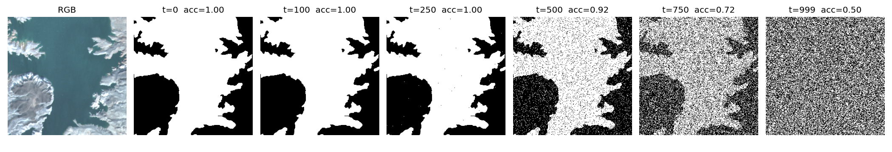

# S2SegDiff: Diffusion-based water segmentation of Sentinel-2 images with self-supervised conditioning

This repo frames semantic segmentation as conditional denoising. A U-Net learns to recover the water mask of a Sentinel-2 chip from pure noise, guided by features of the image itself. The image features come from an encoder pretrained with **Barlow Twins** on unlabeled Sentinel-2 chips, so the denoiser is steered by a representation learned without labels.

<p align="center">
  
</p>
<p align="center"><em>Forward process on a water mask from S2DW. Accuracy is the agreement between the noised mask and the true mask at each timestep (t = 999 is pure noise).</em></p>

**Paper:** C. I. Martinez-Villar and D. T. Anderson, "Aligning Diffusion-based Semantic Segmentation of Sentinel-2 Images via Self-supervised Conditioning," *IEEE JSTARS* (forthcoming). <!-- TODO: arXiv / DOI link -->

**Data:** [S2DW](https://github.com/carlosmartinezvillar/s2dw-lakes-dataset), 256 × 256 chips with 4 bands (R, G, B, NIR at 10 m) and binary water labels.

<!--**Status:** the baseline and Barlow Twins stages run as described below. The conditioned diffusion stage (`pretrain_denoiser.py`, `train_full.py`) is being cleaned up for release. <!-- TODO: remove this line once train_full.py runs end to end -->

<!-- TODO: also add a short "Run the diffusion model" section here once train_full.py is finished -->


## Method

| Component | What it does | Code |
|---|---|---|
| Mask diffusion | Binary masks are mapped to [-1, 1] and noised with a cosine schedule over T = 1000 steps. The model predicts the added noise (MSE loss). Validation sampling uses DDIM with 50 steps. | `diffusion.py` |
| Denoiser | U-Net with CNN and ViT stages. Timestep embeddings modulate each block (scale and shift). | `models.py` (`ConditionedDenoiser`) |
| Image conditioning | A VNIR encoder produces feature maps at each U-Net scale. CNN stages add them through a zero-initialized 1×1 projection, so conditioning starts as a no-op. ViT stages attend to them with cross-attention. | `models.py` (`ConditionCNNEncoder`, `ContextCNNBlock`, `ContextViTBlock`) |
| Self-supervised pretraining | The VNIR encoder is pretrained with Barlow Twins on two augmented views of each chip (GPU-side crops, dihedral flips, blur, gain). | `pretrain_condition.py`, `dataloader.py` |
| Baselines | Supervised U-Nets with every CNN/ViT encoder–decoder combination, plus Barlow Twins encoders probed (frozen) and fine-tuned for segmentation. | `train_base.py`, `train_condition.py` |

## Results

<!-- TODO: fill from the paper. Keep one table; a reader should see the headline number in 5 seconds. -->

| Model | Pretraining | Val IoU (water) | Test IoU (water) |
|---|---|---|---|
| U-Net (CNN–CNN) | none | | |
| U-Net (ViT–ViT) | none | | |
| Barlow Twins encoder + decoder (fine-tuned) | Barlow Twins | | |
| **S2SegDiff** | Barlow Twins | | |

## Setup

```bash
git clone https://github.com/carlosmartinezvillar/s2-dae.git
cd s2-dae
pip install -r requirements.txt
```

Download S2DW (see the [dataset repo](https://github.com/carlosmartinezvillar/s2dw-lakes-dataset)), then pack each split into memory-mapped `.npy` arrays:

```bash
python3 dataloader.py --data-dir /path/to/s2dw_chips --cache-dir /path/to/cache
# writes {training,validation,testing}_bands.npy  (N, 4, 256, 256) uint8
#        {training,validation,testing}_masks.npy  (N, 256, 256)    uint8
```

## Train one model on a single GPU

Every script reads one row (by `id`) from a JSON-lines hyperparameter file in `hpo/`.

```bash
# supervised U-Net baseline
python3 train_base.py --data-dir /path/to/cache --net-dir ./out/models --log-dir ./out/logs \
    --params hpo/base_train.json --id 0

# Barlow Twins pretraining of the conditioning encoder
python3 pretrain_condition.py --data-dir /path/to/cache --net-dir ./out/models --log-dir ./out/logs \
    --params hpo/bt_pretrain.json --id 0

# linear-style probe: freeze the pretrained encoder, train the decoder only
python3 train_condition.py --data-dir /path/to/cache --net-dir ./out/models --log-dir ./out/logs \
    --params hpo/bt_probe.json --id 0 --probe-only
```

## Run full sweeps on Kubernetes

The experiments were run on the [NSF National Research Platform](https://nationalresearchplatform.org/) (Nautilus) as one Kubernetes Job per configuration, using a single A100 each. `k8s/kube_launcher.sh` renders `k8s/<script>_template.yml` once per id and submits it. Each pod clones this repo, copies the cached dataset from a persistent volume, trains, and writes checkpoints, logs, and a `.done` or `.failed` marker back to the volumes.

```bash
# 1. Pretrain every Barlow Twins configuration (240 runs, 500 epochs each)
./k8s/kube_launcher.sh bt_pretrain ./hpo/bt_pretrain.json 0 239

# 2. Probe every pretrained encoder (frozen encoder, decoder only)
./k8s/kube_launcher.sh bt_probe ./hpo/bt_probe.json 0 239

# 3. Pretrain the best encoder from the probe for 1,000 epochs (here: id 7)
python3 -c "import sys; sys.path.insert(0,'hpo'); import experiments as e; e.set_experiments_bt_pretrain_long(7)"
./k8s/kube_launcher.sh bt_pretrain ./hpo/bt_pretrain_long.json 7 7

# 4. Fine-tune encoder + decoder end to end from that checkpoint
python3 -c "import sys; sys.path.insert(0,'hpo'); import experiments as e; e.set_experiments_bt_train(7)"
./k8s/kube_launcher.sh bt_train ./hpo/bt_train.json 0 39
```

Before submitting, the launcher checks that the working tree matches the pushed remote, because pods clone the remote and not your local copy. Prefix any launch with `DRY_RUN=1` to print the manifests without submitting. Sweep definitions live in `hpo/experiments.py`:

| Sweep | Runs | Grid |
|---|---|---|
| `base_train.json` | 280 | encoder ∈ {CNN, ViT} × decoder ∈ {CNN, ViT} × width × ViT depth × batch size, random learning rate and weight decay |
| `bt_pretrain.json` | 240 | encoder ∈ {CNN, ViT} × projector dim ∈ {2048, 4096, 8192} × width ∈ {32, 48}, 20 random samples each |
| `bt_probe.json` | 240 | one probe per pretrained encoder, with fixed probe settings so scores are comparable |

## Repository layout

```
dataloader.py           S2DW cache builder, datasets, GPU augmentations
diffusion.py            Gaussian diffusion (cosine schedule, DDPM and DDIM sampling)
models.py               CNN/ViT blocks, encoders, decoders, Barlow Twins, denoisers
train_base.py           supervised U-Net baselines
pretrain_condition.py   Barlow Twins pretraining of the conditioning encoder
train_condition.py      probe (--probe-only) or fine-tune a pretrained encoder
pretrain_denoiser.py    denoiser pretraining
train_full.py           conditioned diffusion training
hpo/                    sweep generators and JSON-lines hyperparameter files
k8s/                    job templates, per-job scripts, launcher
fig/                    figures
```

## Citation

```bibtex
@article{martinezvillar_s2segdiff,
  author  = {Martinez-Villar, Carlos I. and Anderson, Derek T.},
  title   = {Aligning Diffusion-based Semantic Segmentation of Sentinel-2 Images via Self-supervised Conditioning},
  journal = {IEEE Journal of Selected Topics in Applied Earth Observations and Remote Sensing},
  year    = {TODO},
  note    = {forthcoming}
}
```

## License

MIT <!-- TODO: the repo currently ships GPL-3.0; switch LICENSE if you agree -->
